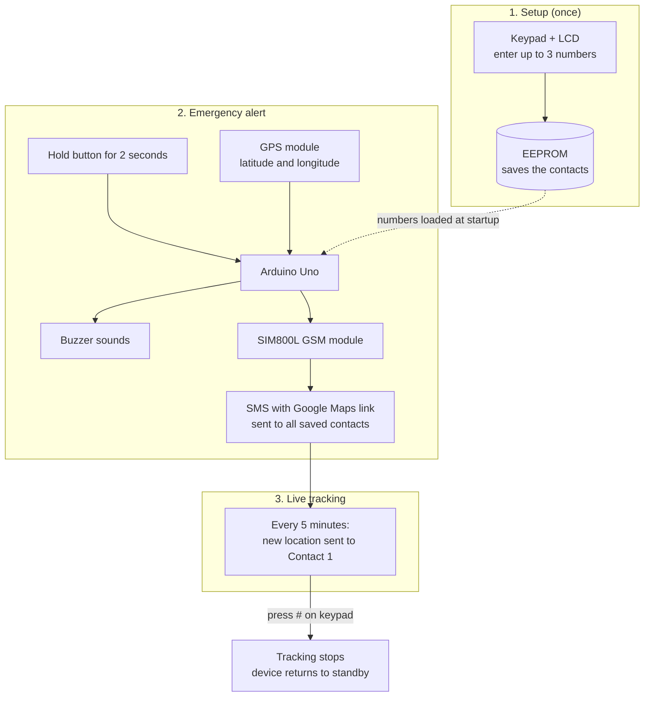

# 🚨 Emergency SOS Tracker

A standalone Arduino device that sends your live GPS location by SMS to your emergency contacts when you hold one button. It works without a smartphone, mobile data, or Wi-Fi.

## Overview

In an accident or emergency, there may be no time to unlock a phone, open an app, or turn on GPS. This device is built so that one physical action is enough.

**Setup (done once).** Using the keypad and LCD, you save up to three phone numbers. They are stored in the Arduino's EEPROM memory, so they are not lost when the power is turned off.

**Emergency.** When you hold the button for 2 seconds, the buzzer sounds to confirm the alert and to attract attention. The GPS module provides the current latitude and longitude, which the Arduino turns into a Google Maps link. The SIM800L then sends this link by SMS to all saved contacts. The 2-second hold is deliberate: it stops accidental presses from sending false alarms.

**Live tracking.** After the first alert, the device keeps sending a fresh location link to the first contact every 5 minutes, so they can follow you as you move. Pressing `#` on the keypad stops tracking and returns the device to standby.

## Components

These are the parts used to build the device.

- Arduino Uno R3
- SIM800L GSM module with a 2G SIM card
- NEO-6M GPS module (with antenna)
- 16x2 I2C LCD display
- 4x4 matrix keypad
- 5V active buzzer
- Push button
- 18650 Li-ion battery (3.7V) with holder
- TP4056 charging module
- LM2596 buck converter
- Resistors: 1k and 2k ohm
- Breadboard, jumper wires, USB cable

## Connections

The table shows which part is wired to which Arduino pin. Pins were chosen so the two software serial ports (GSM and GPS), the I2C display, and the keypad do not overlap.

| Component | Pin | Connected to |
| :--- | :--- | :--- |
| SIM800L | TX | Arduino D2 |
| SIM800L | RX | Arduino D3 |
| SIM800L | Power | LM2596 output (about 4.0V) |
| NEO-6M GPS | TX | Arduino D6 |
| NEO-6M GPS | RX | Arduino D5 |
| I2C LCD | SDA | Arduino A4 |
| I2C LCD | SCL | Arduino A5 |
| Push button | Terminal 1 | Arduino A1 (internal pull-up) |
| Push button | Terminal 2 | GND |
| Active buzzer | + | Arduino A0 |
| Active buzzer | - | GND |
| Keypad | Rows R1-R4 | Arduino D7, D8, D9, D10 |
| Keypad | Columns C1-C4 | Arduino D11, D12, D13, D4 |
| 18650 battery | + / - | LM2596 input |
| TP4056 | Battery terminals | 18650 battery (for charging) |

## Challenges and solutions

**1. GPS and GSM on one Uno.** The Uno can listen to only one `SoftwareSerial` port at a time. The code reads the GPS continuously and switches to the GSM port with `.listen()` only when sending an SMS.

**2. Slow or missing GPS fix.** The first fix can take minutes and often fails indoors. The code checks that the position is valid and otherwise sends "GPS Signal Not Found". Switching the device on near a window or outdoors helps.

**3. Accidental alerts.** A quick press by mistake would send false alarms, so the SOS starts only after a 2-second hold, confirmed by the buzzer.
