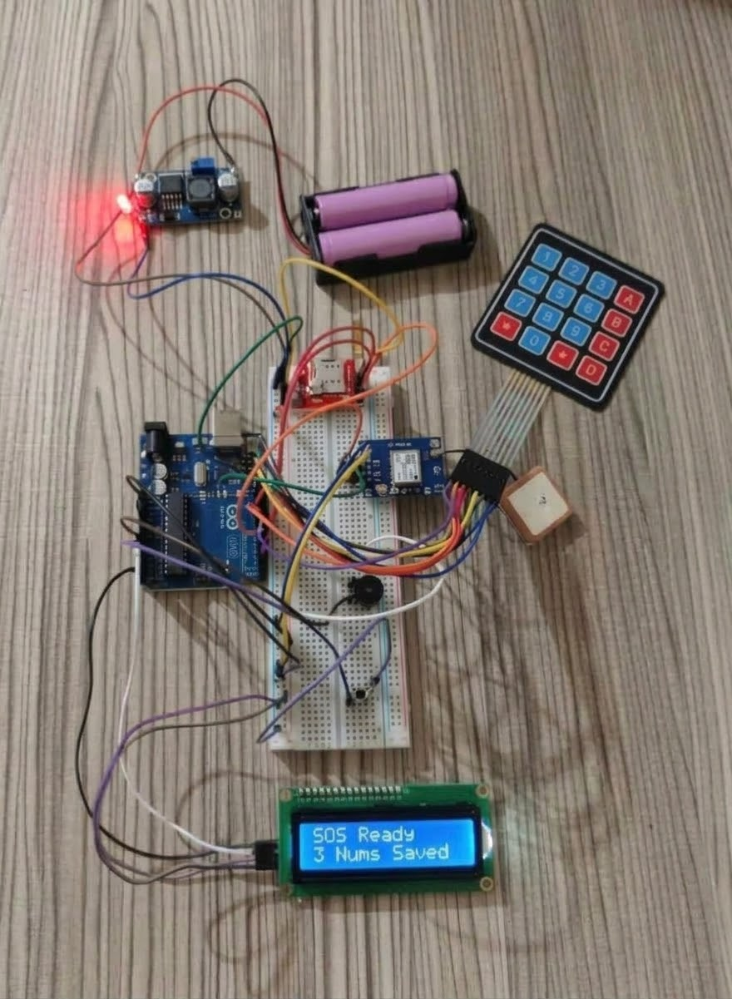

# 🚨 Emergency SOS Tracker

A standalone Arduino device that sends your live GPS location by SMS to your emergency contacts at the press of a button. It needs no smartphone, mobile data, or Wi-Fi.

  

## 📌 Overview

Hold the button for 2 seconds and the device sounds a buzzer, reads its GPS position, and texts a Google Maps link to up to three saved contacts. It then sends an updated location to the first contact every 5 minutes until tracking is stopped from the keypad.

Contacts are stored in EEPROM, so they survive reboots. They can be added, edited, or deleted using the keypad and LCD alone.

## 🛠️ Components

| Component | Qty | Purpose |
| :--- | :-: | :--- |
| Arduino Uno R3 | 1 | Main controller |
| SIM800L GSM module + 2G SIM card | 1 | Sends SMS |
| NEO-6M GPS module (with antenna) | 1 | Latitude and longitude |
| 16x2 I2C LCD | 1 | Status and setup display |
| 4x4 matrix keypad | 1 | Manage contacts, stop tracking |
| 5V active buzzer | 1 | Alarm and key feedback |
| Push button | 1 | SOS trigger |
| 18650 Li-ion battery (3.7V) with holder | 1-2 | Portable power |
| TP4056 charging module | 1 | Battery charging and protection |
| LM2596 buck converter | 1 | Steps down to about 4.0V for the SIM800L |
| Resistors 1k and 2k ohm | 1 each | Voltage divider for SIM800L RX |
| Breadboard, jumper wires, USB cable | 1 set | Wiring and programming |

## 🔌 Wiring

| Component | Pin | Arduino Uno |
| :--- | :--- | :---: |
| SIM800L | TX / RX | D2 / D3 |
| NEO-6M GPS | TX / RX | D6 / D5 |
| I2C LCD | SDA / SCL | A4 / A5 |
| Push button | Terminal 1 / 2 | A1 (pull-up) / GND |
| Active buzzer | + / - | A0 / GND |
| Keypad | Rows R1-R4 | D7, D8, D9, D10 |
| | Columns C1-C4 | D11, D12, D13, D4 |

## ⌨️ Keypad guide

| Key | Action |
| :---: | :--- |
| A, B, C | Select contact slot 1, 2, or 3 |
| 0-9 | Type the number (max 15 digits) |
| # | Save the number |
| D | Backspace. On an empty input, deletes the saved contact |
| # (while tracking) | Stop live tracking |

## 🧗 Challenges and solutions

- **GSM power surges:** The SIM800L restarted during transmission. Fixed with a dedicated LM2596 supply and a common ground.
- **Two serial devices on one Uno:** `SoftwareSerial` listens to one port at a time. Solved by switching with `.listen()` between the GPS and GSM ports.
- **Keeping contacts after power loss:** Stored in the on-board EEPROM.
